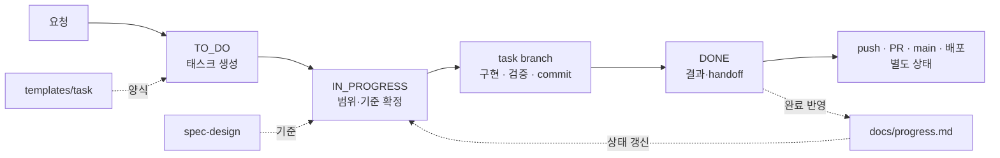

# Local Task Template

프로젝트의 기획·진행·판단·인수인계는 로컬 `.local/`에 보관하고, 코드와 공유 지침은 Git으로 관리하는 재사용 템플릿입니다. 아임해피 개발에서 사용한 태스크·브랜치·worktree 운영 방식을 프로젝트에 종속되지 않게 정리했습니다.

이 저장소의 `template/local/`에는 **공유 가능한 빈 양식과 규칙**만 들어 있습니다. 다른 저장소에 적용하면 `.local/`이 만들어지며 실제 운영 기록은 Git과 GitHub에서 제외됩니다. 원본 프로젝트의 코드·운영 이력·계정 정보는 포함하지 않습니다.

## 처음 시작할 때

에이전트에게 아래 내용을 그대로 요청하세요.

```text
다음 GitHub 저장소와 연결된 로컬 작업공간을 찾아 확인해 주세요.
https://github.com/fliklab/local-task-template

README.md와 AGENTS.md를 먼저 읽고, 로컬 전용 기록인
.local/README.md와 .local/docs/progress.md도 확인해 주세요.
관련 기준 문서와 진행 중인 태스크까지 읽은 뒤,
현재 상황과 다음 작업을 요약해 주세요.

로컬 작업공간이 없다면 URL의 원격 문서를 확인하고,
확인한 내용과 확인할 수 없는 로컬 상태를 구분해 알려 주세요.
```

## `.local` 작업 흐름과 구조

`.local`은 기본 worktree에서 태스크의 상태와 공통 기준을 관리하고, 구현 worktree에서는 symlink를 통해 필요한 기록을 읽는 방식으로 사용합니다. 운영 기록은 Git에서 제외되며, 실제 코드 변경만 task branch에 커밋합니다.

### 작업 흐름



기본 worktree의 조정 담당자는 `TO_DO → IN_PROGRESS → DONE` 이동과 `docs/progress.md` 갱신을 담당합니다. 구현 worktree에서는 공유 `.local`을 운영상 읽기 전용으로 참조하며, 판단과 검증 결과는 handoff를 통해 기본 worktree에 반영합니다.

### 폴더 구조

```text
📁 .local/
├── 📄 README.md            운영 규칙과 읽는 순서
├── 📁 docs/                현재 진행 상황
├── 📁 spec-design/         장기 기준과 설계
├── 📁 references/          원본·참고 자료
├── 📁 external-services/   외부 서비스 기록
├── 📁 tasks/
│   ├── 📁 TO_DO/           시작 전
│   ├── 📁 IN_PROGRESS/     진행 중
│   └── 📁 DONE/            완료·handoff
├── 📁 templates/           새 기록 양식
└── 📁 tools/               운영 점검 도구
```

`tasks/`의 태스크 폴더는 복제되지 않고 상태에 따라 디렉터리 전체가 이동합니다. 개별 파일까지 포함한 상세 구조는 아래 [저장소 구성](#저장소-구성)에서 확인할 수 있습니다.

## 기존 저장소에 적용

Git과 Bash 3.2 이상, macOS·Linux의 기본 명령(`awk`, `find`, `grep`, `mktemp` 등)을 사용합니다. 별도 언어 런타임이나 패키지 설치는 필요하지 않습니다. macOS 기본 Bash에서 실행할 수 있고, Windows에서는 WSL 환경을 사용하세요.

템플릿은 현재 `~/dev/local-task-template`에 있습니다. 다른 컴퓨터에서 처음 받을 때만 다음 명령을 실행합니다.

```sh
git clone https://github.com/fliklab/local-task-template.git ~/dev/local-task-template
```

**적용할 저장소의 터미널에서** 다음 명령을 실행하세요. 저장소 루트 또는 하위 디렉터리 어디에서 실행해도 Git이 실제 루트를 찾습니다. 대상 경로를 생략하면 현재 위치의 저장소를 사용합니다.

```sh
# 미리보기: 실제 대상과 worktree 경로 확인, 파일 변경 없음
bash ~/dev/local-task-template/scripts/init.sh

# 확인한 저장소에 적용
bash ~/dev/local-task-template/scripts/init.sh --apply

# 실제 Git 루트를 사용해 변경·제외 상태 확인
repo_root="$(git rev-parse --show-toplevel)"
git -C "$repo_root" diff -- AGENTS.md .gitignore
git -C "$repo_root" check-ignore .local/README.md
```

다른 위치에서 실행할 때는 실제 저장소 경로를 인자로 줄 수 있습니다. 예를 들어 아임해피 저장소를 **미리보기로 확인**하는 명령은 다음과 같습니다. 이 저장소에는 이미 `.local`이 있으므로 기존 기록 보호를 위해 설치가 중단됩니다.

```sh
bash ~/dev/local-task-template/scripts/init.sh ~/dev/i-am-happy-money-class
```

공백이 있는 경로는 `"$repo_root"`처럼 따옴표로 감쌉니다. 설치는 운영 기록을 관리할 기본 worktree에서 수행하세요. 구현용 worktree는 기본 worktree의 `.local`을 공유합니다.

## 실제 경로가 반영되는 위치

설치 도구는 대상의 `git rev-parse --show-toplevel` 결과를 사용합니다. 프로젝트명은 저장소 디렉터리 이름, worktree 기본 경로는 같은 상위 폴더의 `{저장소 이름}-worktrees`입니다.

| 설치 파일 | 자동 반영 내용 |
|---|---|
| `.local/README.md` | 프로젝트명, 실제 저장소·운영 기록·worktree 경로 |
| `.local/docs/progress.md` | 프로젝트명과 실제 저장소 경로 |
| `.local/spec-design/001-git-workflow.md` | 실제 경로가 들어간 worktree 생성·공유 명령 |

예를 들어 `/Users/flik/dev/local-task-template`의 worktree 기본 경로는 `/Users/flik/dev/local-task-template-worktrees`입니다. 절대 경로는 Git에서 제외되는 `.local` 문서에만 반영하며, 공유할 `AGENTS.md`에는 상대 경로를 유지합니다. `template/local/`의 `{{REPO_ROOT}}` 같은 표식은 설치 도구가 치환하는 양식 문법입니다.

저장소를 다른 위치로 옮기면 `.local/README.md`, `docs/progress.md`, `spec-design/001-git-workflow.md`의 경로와 공유 symlink를 갱신하세요. 아래 README의 Git 기반 명령은 실행 시 현재 경로를 다시 구합니다.

## 기존 파일 보존

설치 도구는 `.local/`을 생성하고 기존 `AGENTS.md`·`.gitignore` 끝에 지침과 제외 규칙을 추가합니다. 기존 내용을 보존하며 자동 stage·commit·push는 하지 않습니다. 기존 `.local`, 이미 추적 중인 `.local`, 중복 설치 표식, symlink로 된 수정 대상 파일이 있으면 중단합니다. 재설치·자동 업데이트는 지원하지 않으며 기존 운영 기록이 있는 저장소는 양식을 수동 비교해 필요한 내용만 반영합니다. 적용 도중 파일시스템 오류가 발생하면 부분 적용 여부를 확인하고 복구해야 합니다.

기존 AGENTS와 추가 지침이 충돌하면 프로젝트의 구체적인 규칙에 맞춰 조정하세요. 신규 저장소는 먼저 `git init -b main`으로 초기화할 수 있습니다. 첫 commit이 없으면 worktree를 만들 수 없으므로 bootstrap branch에서 검증된 초기 파일을 commit하고, 승인된 초기 통합 범위에서 main 기준선을 만드세요.

## 적용 후 설정

1. `.local/docs/progress.md`의 자동 입력된 프로젝트명·경로를 확인하고 현재 단계·조정 담당자를 적습니다.
2. `.local/spec-design/000-project-baseline.md`에 요구·범위·구조·미결정을 적습니다.
3. `002-development-and-verification.md`에 실제 검증 명령을 넣습니다.
4. 기존 branch 정책이 있으면 `001-git-workflow.md`와 루트 `AGENTS.md`를 함께 맞춥니다. 기본은 `agent/{task-id}-{slug}`입니다.
5. 아래 방식으로 첫 태스크를 생성하고 시작합니다.

## 태스크 생성 → 진행 → 완료

처음에는 `000`을 사용합니다. 이후에는 TO_DO·IN_PROGRESS·DONE 전체에서 사용된 최대 번호의 다음 번호를 조정 담당자 한 명이 배정합니다. 아래 명령은 대상 프로젝트 루트에서 실행합니다. 하위 디렉터리라면 먼저 `cd "$(git rev-parse --show-toplevel)"`로 이동합니다.

```sh
cp -R .local/templates/task .local/tasks/TO_DO/000-project-setup
# README의 ID·목적·완료 조건·소유 범위를 채우고 progress에 생성 기록
mv .local/tasks/TO_DO/000-project-setup .local/tasks/IN_PROGRESS/
# README 상태를 IN_PROGRESS로, progress의 현재 작업도 갱신
```

구현 시작 시 base SHA와 owned/shared/excluded 파일을 기록하고 전용 branch·worktree를 만듭니다. 작은 조사·기획 작업은 `.local`만으로 진행할 수 있습니다.

```sh
# 기본 worktree 안에서 실행: 실제 저장소 위치와 이름으로 경로 생성
repo_root="$(git rev-parse --show-toplevel)"
worktree_root="$(dirname "$repo_root")/$(basename "$repo_root")-worktrees"
task_id=000-project-setup
git -C "$repo_root" worktree add -b "agent/$task_id" "$worktree_root/$task_id" main
# 필요한 경우 공유 기록을 읽기 전용 운영 방식으로 참조
ln -s "$repo_root/.local" "$worktree_root/$task_id/.local"
```

판단은 `.note.md`, 실행·완료 기준은 `.tasklist.md`, 검증 결과와 다음 작업자에게 넘길 내용은 `.log.md`에 기록합니다. 검증된 단위가 끝나면 task branch에서 해당 파일만 stage하고 local commit합니다.

```sh
# 구현 worktree에서 실제 소유 파일 경로로 변경하여 실행
git add path/to/changed-file
git diff --cached --check
git diff --cached
# 관련 테스트·비밀값·생성물·OPEN issue를 확인한 뒤
git commit -m 'chore(project): establish project baseline'
```

완료 조건·검증·이슈 처리를 확인하고 handoff에 branch·SHA·push·PR·main 통합·배포 상태를 각각 기록합니다. 기본 worktree의 조정 담당자가 아래 이동과 공유 문서 갱신을 수행합니다.

```sh
mv .local/tasks/IN_PROGRESS/000-project-setup .local/tasks/DONE/
# README 상태를 DONE으로, progress의 결과·다음 작업도 갱신
```

**DONE은 push·main 통합·배포 완료를 뜻하지 않습니다.** local commit은 검증된 단위마다 수행하며, 원격 반영·통합·배포·branch/worktree 삭제는 사용자가 요청하거나 구체적으로 승인한 범위에서 진행합니다.

## 저장소 구성

```text
scripts/init.sh                    기존 저장소 적용 도구 (기본 미리보기)
template/AGENTS.fragment.md         루트 AGENTS에 추가할 공통 지침
template/local/
  README.md                        운영 규칙과 읽는 순서
  docs/progress.md                  현재 진행 상황
  spec-design/                     장기 기준·Git 운영·개발과 검증
  tasks/TO_DO/                     시작 전 태스크
  tasks/IN_PROGRESS/               진행 태스크·교차 영향 이슈 규칙
  tasks/DONE/                      완료·handoff
  templates/task/                  README·원문·체크리스트·판단·handoff 양식
  templates/service.md             서비스별 기록 양식
  external-services/               준비·검증·인수 현황과 이력
  references/                      원본 참고 자료
  tools/check-parallel-impact.sh   모든 worktree와 활성 태스크 이슈 조회
tests/test-init.sh                 설치·보존·Git 제외·worktree 검증
```

교차 영향 조회 도구는 `bash .local/tools/check-parallel-impact.sh`로 실행합니다. 파일 소유권·BLOCKER 해결 여부는 담당자가 판단합니다. 병렬 작업을 하지 않아도 태스크 구조와 handoff 양식을 그대로 사용할 수 있습니다.

## 보관과 인수인계

`.local`은 Git 이력·원격 백업·다른 개발자 clone에 포함되지 않습니다. 필요한 백업은 승인된 별도 로컬/암호화 저장소로 관리하세요. worktree의 symlink는 같은 컴퓨터에서만 유효하며 접근 권한을 강제하지 않습니다. 비밀번호·토큰은 비밀 관리 도구에 저장하고 문서에는 참조 위치만 남깁니다.

외부 공유 문서가 필요하면 승인된 범위로 별도 작성합니다. 내부 기록 전체를 제품 `docs/`로 복사하지 않습니다. 이 템플릿은 특정 언어·프레임워크·모노레포 구조나 CI 서비스를 강제하지 않습니다.

## 템플릿 검증

```sh
bash tests/test-init.sh
```

테스트는 임시 Git 저장소에서 미리보기, 기존 파일 보존, 재설치 거부, 추적 중인 `.local` 보호, symlink 보호, Git 외부 경로 거부, 하위 디렉터리·경로 생략·실제 경로 치환·쉘 특수문자 보호, 태스크 폴더 이동과 공유 worktree 조회를 확인합니다.
